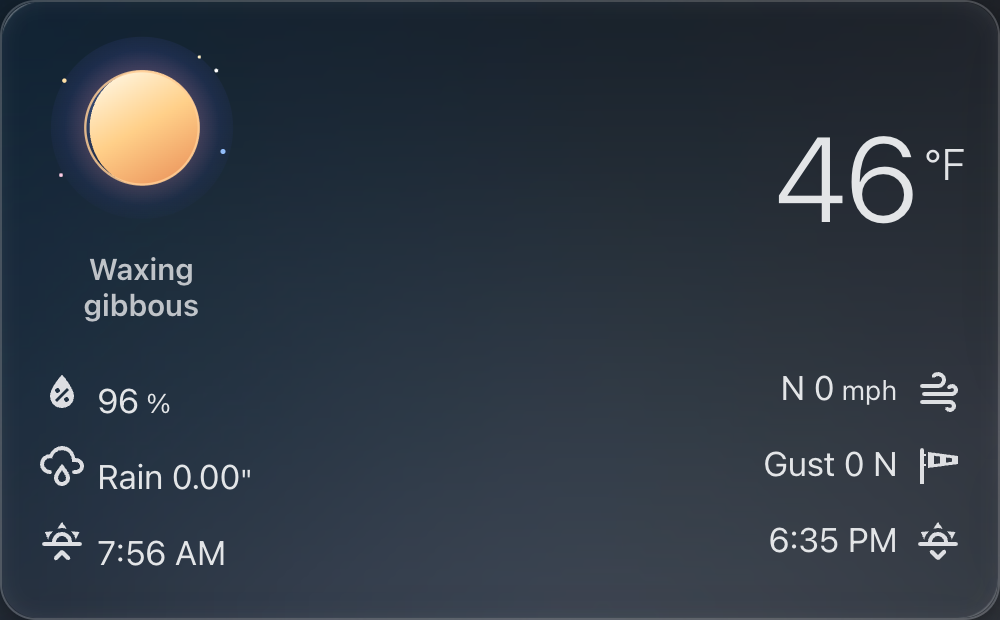

# Lunar Weather Card



A Home Assistant card with the current moon phase, a few outdoor readings, and small drawings that show up when the weather or the calendar matches.

**This card was designed by wjstuben and written by Ai in Cursor.** 

The forecast stays on Home Assistant's own forecast card. This card does not draw one.

## Install

[](https://my.home-assistant.io/redirect/hacs_repository/?owner=wjstuben&repository=lunar-weather-card&category=plugin)

In HACS, add `wjstuben/lunar-weather-card` as a custom dashboard repository. A request to include it in the default store is separate and can take a while.

You can also copy `lunar-weather-card.js` to `config/www/`, add `/local/lunar-weather-card.js` as a JavaScript module under Settings, Dashboards, Resources, and then add the card:

```yaml
type: custom:lunar-weather-card
entity: weather.home
```

Reload the dashboard after adding the resource.

## Options

| Option | What it does |
| --- | --- |
| `entity` | A weather entity. Required. Supplies the condition, clouds, and readings when no station is set. |
| `station_prefix` | Optional. Reads `sensor.<prefix>_temp`, `_humidity`, `_daily_rain`, `_wind_speed`, `_wind_gust`, and `_wind_direction_cardinal`. Leave it out to use the weather entity. |
| `holiday` | `auto` (default), `none`, or one holiday name: `halloween`, `christmas`, `easter`, `valentine`, `newyear`, `patrick`, `thanksgiving`, `groundhog`, `cinco`. |

`auto` follows the calendar. `none` leaves the props off.

## What shows up

The moon phase is calculated in the card for the northern hemisphere. A full moon uses its traditional name. A handful of known blood-moon dates turn the moon red. Clouds follow the weather entity.

Drawings stay out of the way of the readings.

- Below 32°F (0°C): icicles on the temperature.
- A mild day with a freezing night, or a reading below 0°F (−18°C): frost crystals.
- Rain: boots, a leaning umbrella, drops, and a splash.
- Snow: corner drifts and falling flakes.
- Thunderstorm: a small storm cloud and a few lightning bolts. A rainy storm keeps the rain drawings too.
- Strong gusts: leaves. A hot day: sunglasses on the moon. A warm summer evening: fireflies.
- Clear meteor-shower nights: shooting stars.
- Sun up after rain the same day: a small rainbow on the moon.
- Calendar days: Halloween, Christmas, New Year, Valentine's Day, Easter, Pi Day (the moon is a pie), St Patrick's Day, Earth Day (the moon is the Earth), Cinco de Mayo, Independence Day, Groundhog Day, Friday the 13th, and Thanksgiving.

Animations pause when the browser asks for reduced motion.

## Left out on purpose

Nothing from a particular house is in this repository. There is no background photograph, no station name, and no dashboard layout script. Below 0°F the card uses the frost crystals only.
